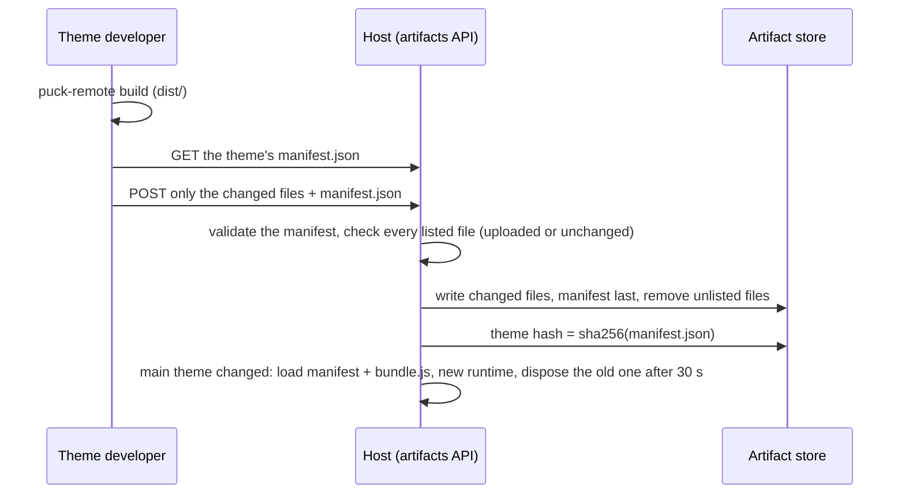

A theme's **files**, its *artifact*, are its code **and its templates**, like a Shopify theme carries its
sections and its `templates/*.json` together ([D-0188](/docs/internal/decisions#D-0188),
[D-0386](/docs/internal/decisions#D-0386)). Because a template always ships with the code it was made
for, there are no content migrations: changing a block's fields and the templates that use it is
one change, pushed at once.

```files
themes/0f3a9c21b7d4
├── manifest.json
├── bundle.js
├── bundle.browser.js
├── bundle.islands.js
├── assets
│   └── theme.css
└── templates
    ├── home.json
    └── search.json
```

| File | Content |
|---|---|
| `manifest.json` | Blocks, root, fields, queries, adapters, categories, and the sha256 of every other file (templates included) |
| `bundle.js` | The theme for the server sandbox: isolate shims, React, `react-dom/server`, the SDK runtime and the theme code |
| `bundle.browser.js` | The theme for the editor: ESM, React and the SDK left to the editor |
| `bundle.islands.js` | Only the theme's `"use client"` modules, hydrated on public pages ([interactive components](/docs/guides/interactive-components)); absent without islands |
| `assets/**` | CSS, client scripts, images |
| `templates/<name>.json` | Templates: Puck data with any root props |

## Themes and versions

Each [theme](/docs/concepts/themes) holds **its current files**, nothing else: there is no history of
older versions ([D-0506](/docs/internal/decisions#D-0506)). A theme's `hash` is the sha256 of its
`manifest.json`, and since the manifest lists every file's sha256, the hash identifies the whole
version ([D-0508](/docs/internal/decisions#D-0508)). To roll back, push an older checkout of the
theme repo.

## Lifecycle



1. `puck-remote build` produces `dist/` (code and templates) on the developer's machine
   ([build pipeline](/docs/internal/architecture/build-pipeline)). A template using a block the
   theme doesn't have fails the build.
2. `puck-remote push` (or `dev`) compares `dist/` with the theme's current manifest and uploads
   **only the files that changed**, plus `manifest.json` ([D-0507](/docs/internal/decisions#D-0507)):
   editing a block sends the bundles, an asset that asset, a template that template.
3. The [artifacts API](/docs/http-api#artifacts-api) validates the new manifest and checks that every
   file it lists was either uploaded, with the right sha256, or is already in the theme unchanged.
   Then it writes the files and updates the theme's `hash`.
4. When the main theme's hash changes, the host loads its `manifest.json` and `bundle.js`, starts a
   new runtime, swaps it in and disposes the previous one after 30 s. It also notices changes made
   elsewhere through the store's `watch`, or by polling every `artifactPollMs` (default 2000 ms,
   [D-0065](/docs/internal/decisions#D-0065)).
5. **Any failure keeps the last good version serving.**

Saving a template from the editor writes two files into the theme: the template and the manifest
(see [Templates and publishing](/docs/guides/publishing)).

## Why the host re-validates

The CLI runs on an untrusted machine. The host therefore has its **own** manifest schema
(`manifest-schema.ts`): closed field types, the `visibleIf` grammar and the query language. It
recomputes `propRefs` and `usesRequestParams` instead of trusting the values the CLI wrote.
Uploaded files are checked against the manifest's sha256 when they are pushed. Once stored, they
are not re-hashed on load: the store is the app's own storage, written through the API
([D-0509](/docs/internal/decisions#D-0509)).

`sdkMajor` versions the wire contract between the SDK and the host. The host only accepts
`sdkMajor: 3` and rejects older themes with an explicit message.

## Storage

Themes and their files live behind the `ArtifactStore` contract ([D-0512](/docs/internal/decisions#D-0512)).
The default `@puck-remote/artifacts-fs` suits a single server; serverless and multi-instance
deployments need a shared store (S3-style). See [Core › Adapters](/docs/core/adapters).

## Serving files

Like Shopify's `/cdn/shop/t/…/assets/…?v=…`, the URL names the file, and `?v=` names its version
([D-0262](/docs/internal/decisions#D-0262)):

```
/cdn/assets/theme.css?v=3fa9c2d81b04
/cdn/bundle.islands.js?v=8e01d77a2c55
```

`v` is the first 12 hex characters of the file's sha256 in the manifest. Pushes and template
saves leave unchanged files alone, so their URLs stay the same and browsers and CDNs keep their
copy.

- The main theme's file is served for its own `v`; a `v` listed by another theme's manifest is
  served from that theme, so previews and the editor on another theme get their files
  ([D-0518](/docs/internal/decisions#D-0518)).
- The bytes are hashed when served: only bytes matching the requested `v` get `immutable` caching.
  During a push, or for a version that no longer exists, the current file is served with
  `no-cache` and an `etag` (`304` when unchanged), so a CDN never keeps other bytes under a
  versioned URL. Relative `url()`s inside your CSS (no `v`) land here too.

Only files listed in the manifest are served, with `nosniff`. `bundle.js`, the manifest and
templates are never served. When the editor is configured, these responses allow the editor origin
(CORS), which loads the browser bundle ([D-0200](/docs/internal/decisions#D-0200)).

Deep dive: [artifact loader](/docs/internal/architecture/artifact-loader).
