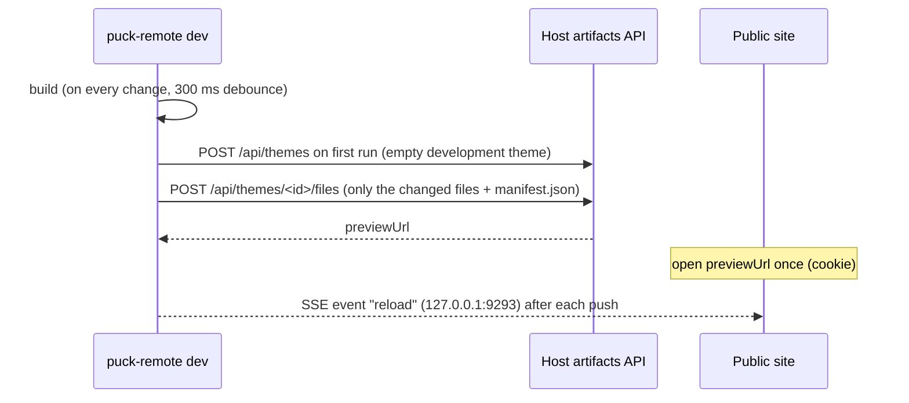

Like `shopify theme dev`, `puck-remote dev` builds your theme on every change and pushes it to a
host. It never touches the live site: it pushes to **your device's development theme**
([D-0446](/docs/internal/decisions#D-0446)), so several developers, or one developer on two
machines, can run `dev` against the same host at once without colliding. This needs a site with
[several themes](/docs/concepts/themes#one-theme-or-several).



<Steps>
<Step>

### Set up the host

The app mounts the [artifacts API](/docs/http-api#artifacts-api) with its own authorization,
enables several themes and configures previews:

```ts title="app/api/themes/[[...path]]/route.ts"
export const { GET, POST, PATCH, DELETE } = remote.createArtifactsHandler({
  authorize: (request, action) => checkToken(request, action),
});
```

```ts title="app/theme/preview/route.ts"
export const { GET } = remote.createPreviewHandler();
```

```ts title="puck-remote.config.ts"
export default defineConfig({
  // …
  themes: { multiple: true },
  origins: { host: [...], editor: '...', site: 'https://www.example.com' },
  preview: { secret: process.env.PREVIEW_SECRET! },
});
```

`authorize` receives what the request wants (`action.kind`, `action.theme`). You can give
developers tokens that may only manage `development` themes and keep publishing for your release
pipeline.

</Step>
<Step>

### Configure the CLI

The theme repo says where the API is and how to authenticate, in whatever way your `authorize`
expects ([CLI configuration](/docs/cli/configuration)):

```ts title="puck-remote.cli.ts"
import { defineCliConfig } from '@puck-remote/cli/config';

export default defineCliConfig({
  url: 'https://admin.example.com/api/themes',
  headers: { authorization: `Bearer ${process.env.DEPLOY_TOKEN}` },
});
```

</Step>
<Step>

### Run `dev`

```bash
puck-remote dev
```

```
[puck-remote dev] Development (a3f9c1-alices-macbook) #0f3a9c21b7d4 → 1d361ac2d6ec
[puck-remote dev] preview: https://www.example.com/theme/preview?token=…&reload=http%3A%2F%2F127.0.0.1%3A9293
[puck-remote dev] live reload on http://127.0.0.1:9293
[puck-remote dev] watching /home/alice/my-theme
```

The first run creates the development theme, named after your device, and remembers its id in
`~/.config/puck-remote/dev-themes.json` (per API). Later runs reuse it. It is deleted after 7 days
without a push (`themes.devExpiryDays`), and the next `dev` then creates a new one. Use `-t <theme>`
to develop on an existing theme instead. A failed build is printed and the theme keeps its last good
version.

</Step>
<Step>

### Preview

Open the preview link: the site sets a cookie for this browser (it expires with the link,
`preview.ttlSeconds`) and every template then renders **your theme**, never cached. Preview pages
**reload by themselves** after each push: `dev` runs a small Server-Sent Events server on your
machine (`127.0.0.1:9293`, or the next free port) and the link tells the site about it
([D-0485](/docs/internal/decisions#D-0485)). Turn it off with `--no-reload` or `dev: { reload: false }`. Other visitors
still see the main theme. Leave with `/theme/preview?exit`. Templates rendered from a preview
have `template.preview` set (`{ theme: { id, name, role } }`), so the app can show a banner.

In the admin, open the editor on your theme (the example app's theme library has a **Customize**
link, `?theme=<id>`). Saving there changes your theme, not the main one.

</Step>
<Step>

### Share and release

Your theme's templates come from your repo: each push replaces the templates on it, including what
someone edited there in the editor. Run `pull -t <id>` first to keep those edits.

To show work to someone, `puck-remote share` creates an unpublished theme
(`Share (a3f9c1-alices-macbook)`) and prints its preview link. To release, pull the live templates
and push to the main theme, or push to an unpublished theme and publish it:

```bash
puck-remote pull
```

```bash
puck-remote push --unpublished --name "Summer sale"
```

```bash
puck-remote publish -t "Summer sale"
```

Delete your development theme (and its files) when you are done:

```bash
puck-remote delete --development
```

</Step>
</Steps>

## Limits

- Live reload reloads the whole page (no hot module replacement or CSS swap), and only in the browser
  that opened the link `dev` printed. The admin editor does not reload.
- Each previewed theme runs in its own sandbox. The host keeps at most
  [`previewRuntimes.max`](/docs/configuration#artifacts) of them (default 3) and disposes idle ones.
- `dev` rebuilds the whole theme on every change (fast, esbuild); only the files whose content
  changed are sent.
