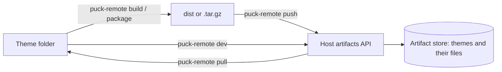

Theme developers use the CLI; the host never builds theme code. `build` turns a theme folder
(blocks and templates) into its files (`dist/`) and `package` packs them into one file. The other commands
talk to the host's [artifacts API](/docs/http-api#artifacts-api) and mirror `shopify theme`: `push`
uploads into a [theme](/docs/concepts/themes) only the files that changed, `publish` makes a theme live, `dev`
pushes every change to your device's development theme, `pull` brings templates edited in the editor
back into the repo, and `list`, `rename`, `delete`, `duplicate` and `share` manage themes.

```npm
npm install -D @puck-remote/cli
```



```json title="package.json"
{
  "scripts": {
    "build": "puck-remote build",
    "release": "puck-remote push --live",
    "dev": "puck-remote dev",
    "pull": "puck-remote pull"
  }
}
```

```ts title="puck-remote.cli.ts"
import { defineCliConfig } from '@puck-remote/cli/config';

export default defineCliConfig({
  url: 'https://admin.example.com/api/themes',
  headers: { authorization: `Bearer ${process.env.DEPLOY_TOKEN}` }, // whatever your host's authorize expects
});
```

See [Configuration](/docs/cli/configuration).

<Cards>
  <Card title="Commands" href="/docs/cli/commands" />
  <Card title="Configuration" href="/docs/cli/configuration" />
  <Card title="Build output" href="/docs/cli/build-output" />
  <Card title="Programmatic API" href="/docs/cli/programmatic-api" />
  <Card title="Local theme development" href="/docs/guides/theme-dev" />
</Cards>
