`ArtifactLoader` holds the **main** theme's current version: `{ id, theme, hash, manifest, bundle,
runtime }`, where `id` is the version key `<theme>-<hash>` ([D-0515](/docs/internal/decisions#D-0515)).
Other themes are loaded on demand by the [preview runtimes](/docs/internal/architecture/themes-and-preview).

## `loadArtifact(theme)` (`loadThemeFiles`)

1. Read the theme's `manifest.json`; its sha256 is the version's `hash`.
2. Parse it as strict UTF-8 JSON and validate it with the host's zod schema (`manifestSchema`).
3. Recompute `propRefs` and `usesRequestParams` from the specs (never trust the CLI).
4. Read `bundle.js` (it must be listed).

Files are **not** re-hashed on load ([D-0509](/docs/internal/decisions#D-0509)). They were checked
against the manifest when they were pushed ([write path](/docs/internal/architecture/themes-and-preview#write-path)),
and the store is the app's own storage. Since a theme's files are written in place, a load during
a push may read the previous manifest; the change notice that follows reloads. Any error →
`ArtifactError`.

## `reload({ force? })`

```mermaid
stateDiagram-v2
  [*] --> Serving
  Serving --> Checking: theme list changed
  Checking --> Loading: main theme id or hash differs
  Checking --> Serving: same version
  Loading --> Swapping: manifest valid, bundle.js present
  Loading --> Serving: rejected (keep last good)
  Swapping --> Serving: new runtime; old disposed after 30 s
```

Serialized (concurrent calls queue). Reads the main theme from the list (`mainTheme`); a main theme
without files is an error. If its `<id>-<hash>` is the one serving, nothing happens. Otherwise it
loads the version, creates a runtime through the renderer factory, swaps it in, and disposes the
previous runtime after **30 s** (`disposeGraceMs`) so in-flight requests finish. **It never
throws**: on failure it logs `REJECTED theme update, still serving <id>` and keeps the last good
version.

## `watch(pollMs)`

Uses the store's `watch` change feed when present (fs: a directory watcher on `themes.json`);
otherwise polls `readThemes()` every `artifactPollMs`
([D-0512](/docs/internal/decisions#D-0512), [D-0065](/docs/internal/decisions#D-0065)). Changes made
through `core.themes` (the API, the admin, `writeTemplate`) also reload right after the main
theme's hash changes. Timers are `unref`'d.

## The host

`createHost(config)` wires the loader and the preview runtimes (`ArtifactRuntimes`) with
`renderer({ id, bundle, limits: config.isolate })` and creates the data and HTTP sources.
The renderer is chosen here, not in `config.ts`, so the config entry never imports isolated-vm.

## Theme file URLs

`handleTheme` resolves `<routes.theme>/<path>?v=<v>` with `ThemeFiles` (`static-files.ts`,
[D-0518](/docs/internal/decisions#D-0518)):

1. It reads the theme list. When its version changed, it rebuilds a `path + v → theme` index from
   every theme's current manifest (manifests are cached per `<id>-<hash>`, which never changes).
   Unknown `v`s never trigger a scan.
2. If the main theme's manifest lists `path` with that `v`, the main theme's file is read;
   otherwise the theme the index names.
3. The bytes are hashed: only bytes matching the manifest's full sha256 for that `v` are served
   `immutable`. Otherwise (a push in progress, a version that no longer exists), and without `v`,
   the main theme's file is served with `no-cache` and an `etag` of the bytes
   ([D-0267](/docs/internal/decisions#D-0267)), so no cache ever keeps other bytes under a versioned
   URL.

URLs are built by `themeFileUrl` and
`assetVersions` (`shared/urls.ts`). The host passes `assetVersions` in the isolate's ctx input, so
`ctx.assetUrl` appends `?v=`; the editor computes the same map from `manifest.files`
([D-0268](/docs/internal/decisions#D-0268)). Themes built with an older SDK ignore `assetVersions`,
so their asset URLs have no `v` and are served as the current file.

<Source path="packages/core/src/server/static-files.ts" />
<Source path="packages/core/src/shared/urls.ts" />
<Source path="packages/core/src/server/artifact-loader.ts" />
<Source path="packages/core/src/server/host.ts" />
<Source path="packages/artifacts-fs/src/index.ts" />
<Source path="packages/core/test/artifacts.test.ts" />
