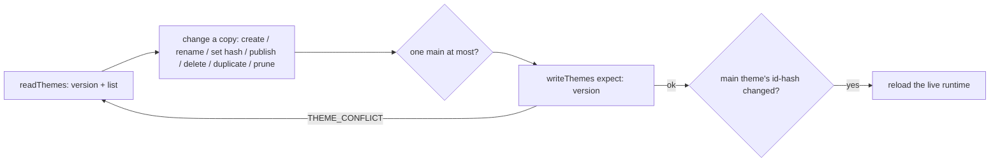
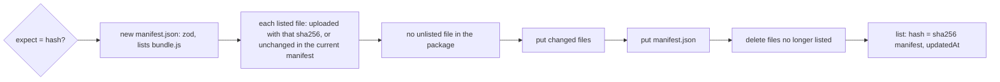
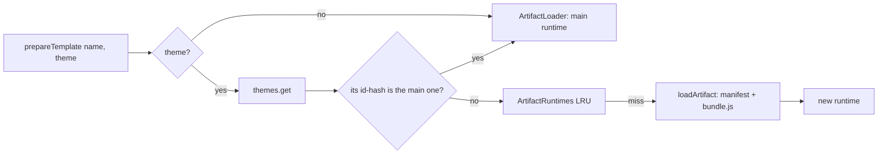
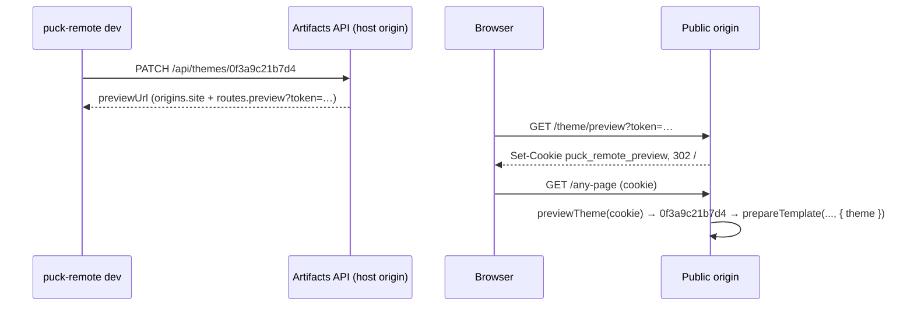
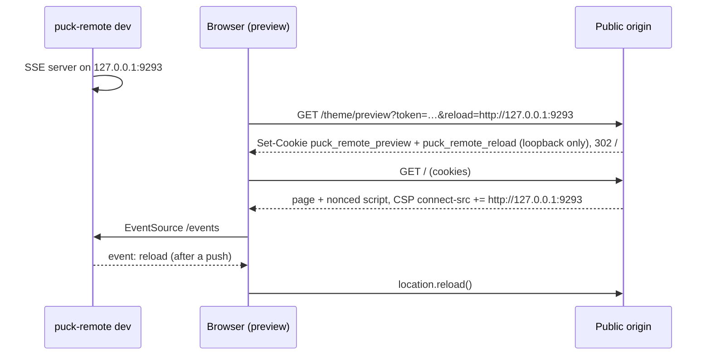
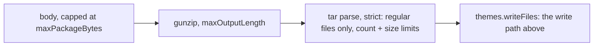

## Themes

The store keeps the theme list and each theme's current files
([D-0512](/docs/internal/decisions#D-0512)); every rule is in `themes.ts`
([D-0516](/docs/internal/decisions#D-0516)). Each list operation is a read-change-write:

- Rules checked on the copy: role is one of the three, the name is 1 to 50 characters without
  control characters, at most one `main`, `main` only created when there is none, a theme without
  files (`hash: null`) is never published, the main theme is never deleted, and in single mode
  (`themes.multiple: false`) nothing but one main theme ([D-0460](/docs/internal/decisions#D-0460)).
- A stale version (another writer got in between) is retried, up to 5 attempts. A failed `expect`
  is not retried: it means the theme moved, and the caller decides.
- Ids are 12 random hex characters, generated by the core and checked against the list.
- `prune()` removes `development` themes whose `updatedAt` is older than `themes.devExpiryDays`. The
  API runs it before `GET /api/themes` and `POST /api/themes`, so expiry needs no timer
  ([D-0461](/docs/internal/decisions#D-0461)); their files are deleted too.
- `ArtifactLoader` serves the main theme (`mainTheme`, edge-safe in `main-theme.ts`, also used by
  the proxy's cacheability) ([D-0515](/docs/internal/decisions#D-0515)).

## Write path

`themes.writeFiles(id, files, { expect? })` is the only way files enter a theme: the API's
`POST /api/themes/<id>/files` and `core.writeTemplate` (template + manifest) both use it
([D-0514](/docs/internal/decisions#D-0514)).

- Unchanged files are trusted from the **current manifest**, not re-read, so a partial push of a
  template never reads the theme's large assets.
- Files are written in place, one atomic rename per file (`artifacts-fs`), `manifest.json` last,
  then removals, then the list ([D-0509](/docs/internal/decisions#D-0509)). A reader can see a mix
  of old and new files while a push writes. The loader only reacts to the list's `hash`, which is
  written last, and the theme file server never caches mismatched bytes as `immutable`.
- Concurrent pushes to the same theme are not serialized: `expect` makes the CLI (`dev`) and the
  editor detect a change made since they last looked; two writers racing without `expect` can
  interleave files (known gap).

`artifacts-fs` stores `themes.json` (temp file + rename), versioned by the file's sha256, and each
theme's files under `themes/<id>/` ([D-0513](/docs/internal/decisions#D-0513)). List writes run under
`.themes.lock`, created with `O_EXCL`; a lock older than 10 s belongs to a crashed writer and is
removed. Its watcher reports changes of `themes.json`.

## Rendering a non-main theme

`prepareTemplate`, `readTemplate`, `editorPayload` and `resolveBlockData` accept `{ theme }`, a
theme id ([D-0456](/docs/internal/decisions#D-0456)). The core looks it up in the list: an invalid
or unknown id behaves like an unknown template.

`ArtifactRuntimes` (`preview-runtimes.ts`) caches runtimes of non-main theme versions, keyed
`<id>-<hash>`. It is LRU-bounded
by `previewRuntimes.max` (default 3), and each entry is disposed after `previewRuntimes.idleMs`
(default 10 min) without use ([D-0413](/docs/internal/decisions#D-0413)). Evicted runtimes get the
same 30 s grace as the live one. A failed load is not cached. Each theme version still gets one
isolate ([D-0026](/docs/internal/decisions#D-0026)).

A template rendered from a theme carries `preview: { theme: { id, name, role } }` and
`cacheable: false`.

## Preview links

The token is `base64url(JSON { t, exp }).base64url(HMAC-SHA256(preview.secret, payload))`, `t`
being a theme id ([D-0462](/docs/internal/decisions#D-0462)), compared with `timingSafeEqual`. The cookie holds the
token itself, so its expiry is checked on every request. It is `HttpOnly` and `SameSite=Lax`, and
theme scripts on the public origin cannot read it. A preview only selects which theme renders:
it grants nothing else, and every theme's files went through the same write path as the main one's. No
link is made for the main theme or on a single-theme site.
The Next proxy sees the cookie (`PREVIEW_COOKIE` from `/edge`) and sends
`private, no-store`, so a CDN never caches a preview ([D-0480](/docs/internal/decisions#D-0480)).

## Live reload

`puck-remote dev` starts `startReloadServer` (`reload-server.ts`): a `node:http` server on
`127.0.0.1` (port 9293, then the next free one up to +10) answering `GET /events` with
`text/event-stream` and `access-control-allow-origin: *`, a `: ping` comment every 15 s, and an
event `reload` with `{ theme, hash }` after each successful push
([D-0491](/docs/internal/decisions#D-0491), [D-0536](/docs/internal/decisions#D-0536)).

- The reload URL is accepted only as `http:` on `127.0.0.1`, `localhost` or `[::1]` with a port, no
  path, query or credentials (`reloadOrigin`, edge-safe in `shared/preview-cookie.ts`), at the
  preview route, in the core and in the proxy. A crafted link can therefore only make a preview page
  listen to the visitor's own machine, and the only effect of an event is a reload.
- The script is rendered only for a preview (`preview.reload` needs `theme`), with the request's
  CSP nonce; `connect-src` is widened for that response only, when both cookies are present
  ([D-0495](/docs/internal/decisions#D-0495)).

## The artifacts API

`handleArtifactsApi(config, themes, sub, request, { authorize })` (`artifacts-api.ts`):

1. Match the route and method first (404/405 without calling `authorize`). Theme routes look the
   stored theme up, and `POST /api/themes` and `duplicate` read their small JSON body (4 KB cap), so
   the action can say which theme and role are concerned ([D-0537](/docs/internal/decisions#D-0537)).
2. Call the app's `authorize(request, action)` before running anything and before any package body
   is read; no `authorize` → 500.
3. Run the action with `core.themes`; `ThemeError` statuses and `THEME_CONFLICT` (409) become JSON
   errors.

### Packages

The body is streamed with a byte cap, so an oversized upload is cut off without being buffered.
Gunzip has an output limit (a zip bomb stops early), and the tar parser (`tar` 7.5.22,
[D-0434](/docs/internal/decisions#D-0434)) refuses links, devices, duplicates and more than
`api.maxFiles` entries. The store's `writeFiles` still checks paths itself.

The API is a host-origin surface. The Next proxy passes it through only on `origins.host`, and
`createArtifactsHandler` checks the origin again. It sends no CORS headers: only non-browser
clients with a token use it ([D-0422](/docs/internal/decisions#D-0422)).

<Source path="packages/sdk/src/host.ts" />
<Source path="packages/artifacts-fs/src/index.ts" />
<Source path="packages/core/src/server/themes.ts" />
<Source path="packages/core/src/server/main-theme.ts" />
<Source path="packages/core/src/server/artifacts-api.ts" />
<Source path="packages/core/src/server/package.ts" />
<Source path="packages/core/src/server/preview.ts" />
<Source path="packages/core/src/server/preview-runtimes.ts" />
<Source path="packages/core/src/core.ts" />
<Source path="packages/next/src/proxy.ts" />
<Source path="packages/cli/src/dev.ts" />
<Source path="packages/cli/src/api-client.ts" />
<Source path="packages/cli/src/themes.ts" />
<Source path="packages/cli/src/config.ts" />
<Source path="packages/cli/src/reload-server.ts" />
<Source path="packages/core/src/shared/preview-cookie.ts" />
<Source path="packages/core/src/react/PuckRemoteTemplate.tsx" />
